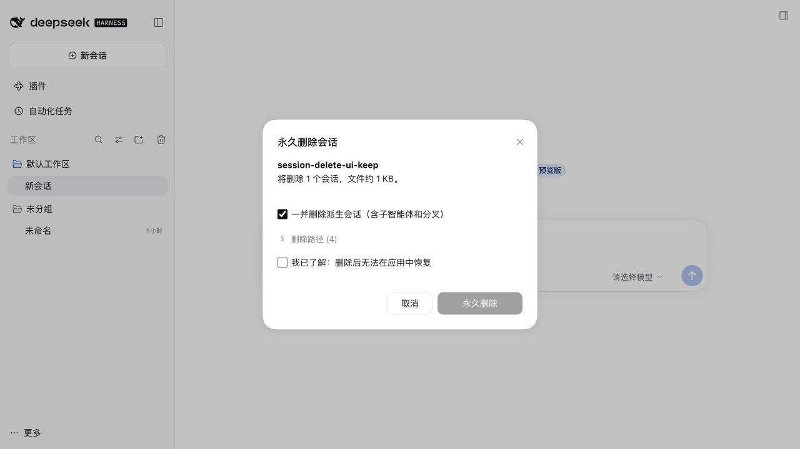

# DeepSeek Harness 会话删除插件


为 DeepSeek Harness 桌面版和 Web 版添加会话永久删除功能。



## 功能

- 会话行 `…` → **删除会话…**，支持已归档会话，确认前可查看删除路径。
- 默认包含子智能体和分叉；存在派生会话时不能只删除父会话。
- “工作区”标题行最右侧的垃圾桶可扫描并清理已删除会话的残留。

## 安装

仅适配 **DeepSeek Harness 0.2.1-rc.2**，支持从 npm 安装或下载安装包。

### 从 npm 安装

```sh
# 桌面版
dsh plugin --profile desktop add dsh-session-delete-local

# Web 版：在服务端安装
dsh plugin --profile web add dsh-session-delete-local
```

### 下载安装

在 [GitHub Actions 的 Verify 构建](https://github.com/lynn12866/dsh-session-delete/actions/workflows/verify.yml)中，打开最新成功的构建，下载 **Artifacts → dsh-session-delete-local**（需登录 GitHub）。解压下载的 ZIP，得到 `.tgz` 安装包；仅在 Windows、macOS、Linux 的 Node.js 22、24 检查全部通过后生成。

也可直接下载 npm 已发布的 [1.3.5 安装包](https://registry.npmjs.org/dsh-session-delete-local/-/dsh-session-delete-local-1.3.5.tgz)。

```sh
# 桌面版：替换为下载文件的绝对路径和实际版本
dsh plugin --profile desktop add file:/absolute/path/dsh-session-delete-local-1.3.5.tgz

# Web 版：将安装包放到服务端，在服务端执行
dsh plugin --profile web add file:/absolute/path/dsh-session-delete-local-1.3.5.tgz
```

安装或更新后重启应用 / Web 服务。

## 限制

- **永久删除，不提供应用内恢复。** 仅清理已识别的会话数据，保留工作区文件、共享附件和外部备份。详见 [清理范围](./CLEANUP_SCOPE.md)。
- 运行中或被占用的会话不能删除；操作前关闭共用同一存储的其他实例。Web 版操作服务端数据。
- 仅支持内置 JSONL 后端（含 Zstandard 压缩日志）；Windows / Linux 尚未实机验证。

## 开发与发布

要求 Node.js ≥ 22.18、pnpm 11.5.0。

```sh
pnpm install --frozen-lockfile
pnpm verify               # 格式、类型、构建和单元测试
pnpm pack --pack-destination artifacts  # 校验、构建并生成本地安装包
pnpm release --dry-run    # 校验并预览 npm 包
pnpm release              # 登录 npm 后校验、构建并发布
```

再次发布前更新 `package.json` 的 `version`。开发规范和集成测试见 [CONTRIBUTING.md](./CONTRIBUTING.md)。

[MIT](./LICENSE)
